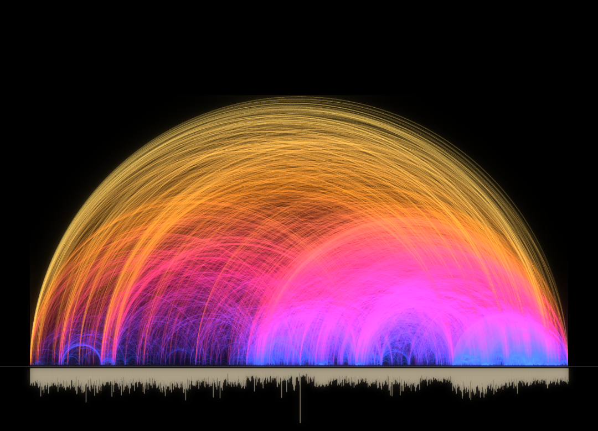
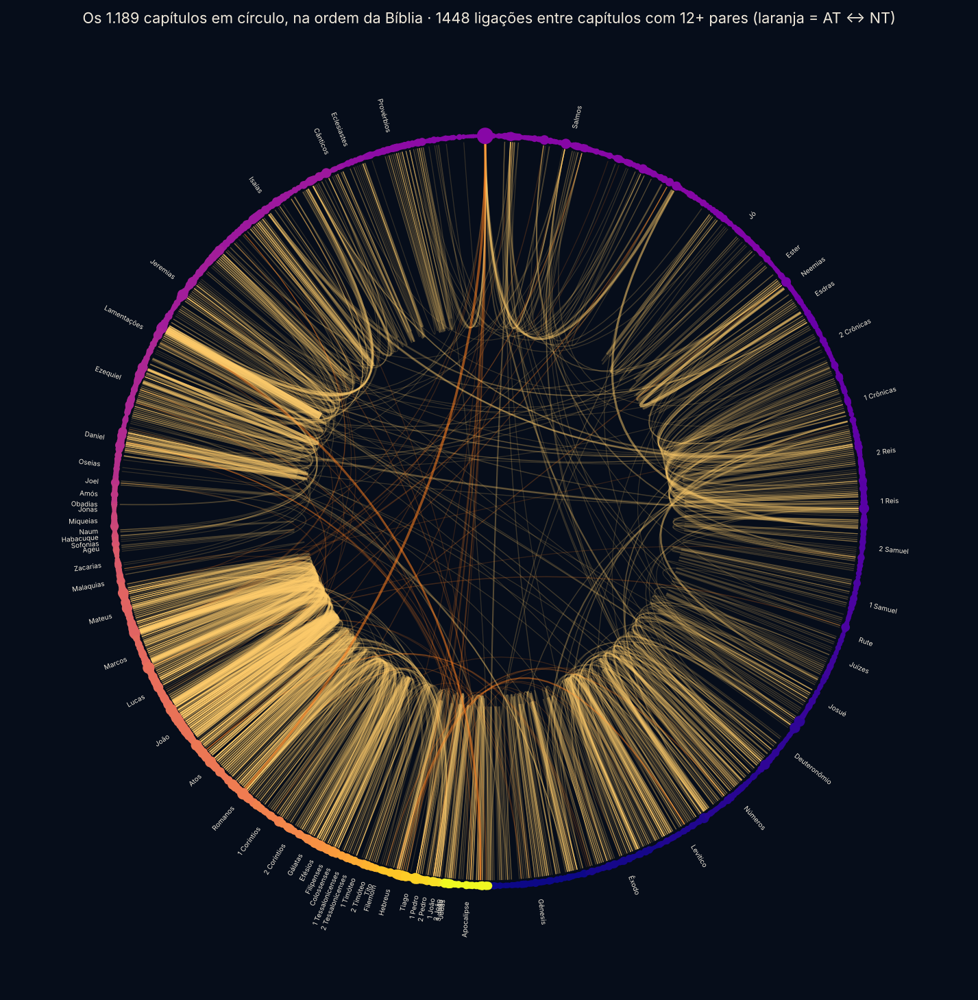
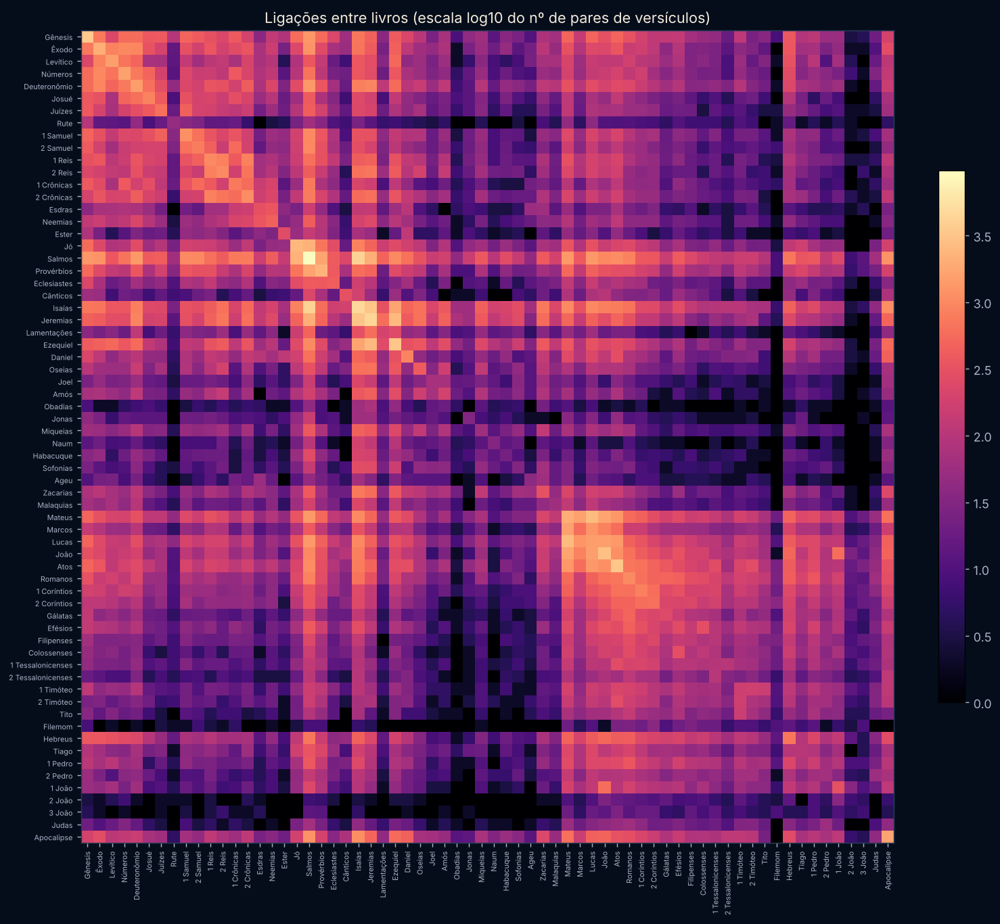
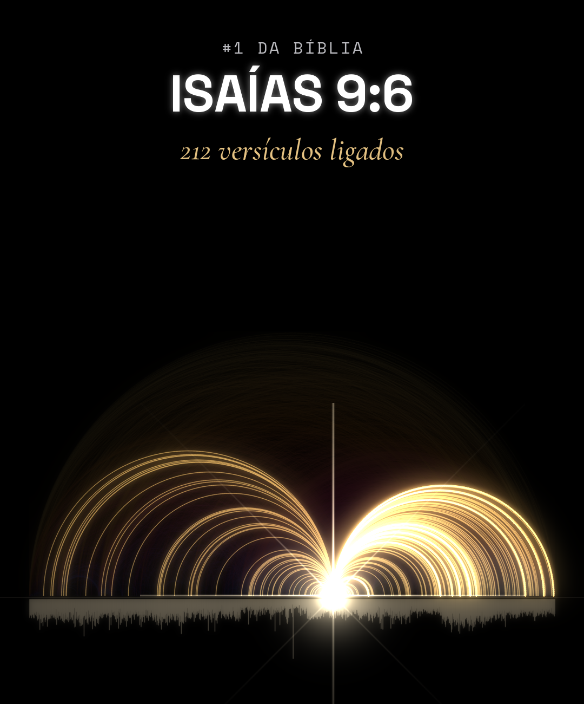
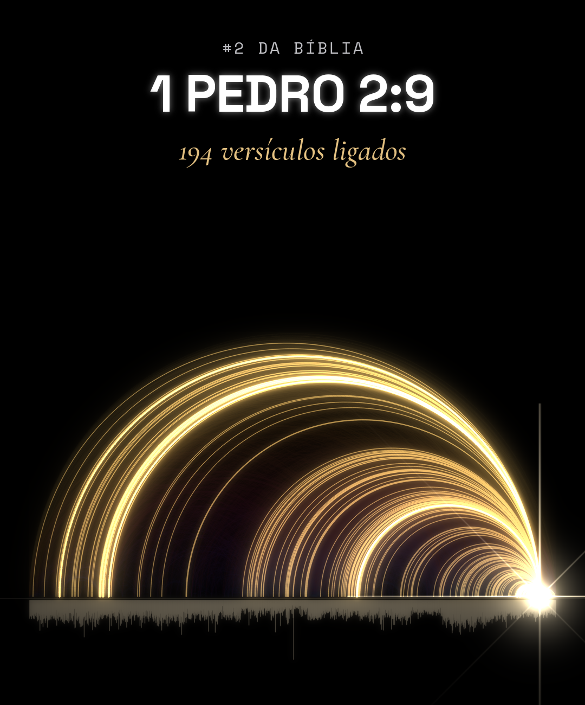

# Bíblia Conectada

**O grafo da Bíblia, aberto para todo mundo.** 31.102 versículos, 344.799 referências cruzadas, hebraico e grego palavra por palavra, lugares, pessoas e eventos: tudo em fontes livres, com código que calcula cada número, pronto para estudar, visualizar e construir em cima.



> Estado em 19/10/2026: dados, grafo e estudos prontos. O site navegável (estilo Obsidian, em português) está em construção no [PR #1](https://github.com/alexpiraginet-bot/biblia-conectada/pull/1). O plano completo está em [HANDOFF.md](HANDOFF.md).

---

## Os números (todos calculados por código, nada digitado à mão)

| | |
|---|---|
| Livros · capítulos · versículos | 66 · 1.189 · 31.102 |
| Referências cruzadas (OpenBible.info) | **344.799** |
| Pares únicos de versículos (os arcos) | 301.584 |
| Pares que cruzam Antigo ↔ Novo Testamento | 67.293 |
| Versículos com pelo menos uma ligação | 30.303 (97,4%) |
| Ligações por versículo: média · mediana | 19,4 · 15 |
| Arestas do grafo de capítulos | 142.082 |
| Pares de livros ligados | 2.036 dos 2.145 possíveis |
| **Versículo mais ligado** | **Isaías 9:6**, "porque um menino nos nasceu": 212 versículos |
| **Par mais votado** | **Isaías 41:10 ↔ Filipenses 4:13**: 1.477 votos |

"Ligações" de um versículo = versículos diferentes ligados a ele na base, qualquer voto. Em 2007, o pastor Christoph Römhild e o pesquisador Chris Harrison desenharam 63.779 referências; a base aberta de hoje tem 5,4 vezes mais.

---

## O que tem no repositório

| Pasta | Conteúdo |
|---|---|
| [`grafo/`](grafo/) | **O grafo pronto para usar:** arestas em CSV e binário, grau de cada versículo, grafo de capítulos (CSV, GEXF para Gephi, JSON), matriz livro × livro, resumo, rankings e 16 imagens. Tudo gerado por `grafo/build.py` |
| [`fontes/`](fontes/) | **As bases abertas, cópia exata:** texto bíblico em 7 línguas, hebraico e grego com morfologia e Strong, léxicos, versificação, nomes próprios, lugares, pessoas e eventos. 123 arquivos, cada um com SHA-256 e licença conferida; índice em [`fontes/catalogo.json`](fontes/catalogo.json) |
| [`estudos/`](estudos/) | **Os três vídeos** que deram origem ao projeto, com código, dados, mídia e o vídeo final |
| [`design/`](design/) | Direção visual do site: tokens com contraste calculado, layout, interação, movimento e referências |
| [`scripts/`](scripts/) | `fetch_sources.sh` baixa todas as fontes de novo e confere com os checksums |
| branch [`film-intermediates`](https://github.com/alexpiraginet-bot/biblia-conectada/tree/film-intermediates) | Masters e mixagens dos vídeos (cerca de 750 MB), fora do `main` para o clone continuar leve |

---

## O grafo em imagens

| | |
|---|---|
|  |  |
| **Os 1.189 capítulos em círculo**, na ordem da Bíblia: 1.448 ligações entre capítulos com 12+ pares. Laranja = Antigo ↔ Novo Testamento. Os paralelos saltam aos olhos: Reis ↔ Crônicas, os Evangelhos entre si, Salmos com tudo | **Livro × livro** (escala log): o par mais ligado é Salmos ↔ Isaías, com 4.099 pares de versículos; depois Isaías ↔ Jeremias (3.090) e Mateus ↔ Lucas (2.587) |
|  |  |
| **Isaías 9:6**, o versículo mais ligado da Bíblia: 212 versículos, 120 no AT e 92 no NT | **1 Pedro 2:9**, o segundo: 194 versículos, 116 no AT e 78 no NT |

Os 12 versículos mais ligados têm o próprio mapa em [`grafo/imagens/`](grafo/imagens/), no estilo dos vídeos. A distribuição das ligações está em `distribuicao-ligacoes.png`.

---

## Rankings (completos em [`grafo/RANKINGS.md`](grafo/RANKINGS.md))

**Os 10 versículos mais ligados**

| # | Versículo | Ligações | No AT | No NT |
|---|---|---|---|---|
| 1 | Isaías 9:6 | 212 | 120 | 92 |
| 2 | 1 Pedro 2:9 | 194 | 116 | 78 |
| 3 | Mateus 28:20 | 169 | 102 | 67 |
| 4 | Tito 2:14 | 157 | 67 | 90 |
| 5 | Isaías 41:10 | 156 | 127 | 29 |
| 6 | Apocalipse 5:9 | 156 | 67 | 89 |
| 7 | Apocalipse 11:15 | 156 | 109 | 47 |
| 8 | Hebreus 12:2 | 153 | 34 | 119 |
| 9 | Atos 26:18 | 150 | 42 | 108 |
| 10 | Miqueias 7:18 | 148 | 120 | 28 |

**Os 5 pares Antigo ↔ Novo Testamento mais votados**

| # | Antigo Testamento | Novo Testamento | Votos |
|---|---|---|---|
| 1 | Isaías 41:10 | Filipenses 4:13 | 1.477 |
| 2 | Jeremias 1:5 | Romanos 8:29 | 1.232 |
| 3 | Isaías 44:3 | Atos 2:17 | 919 |
| 4 | Provérbios 4:23 | Lucas 6:45 | 891 |
| 5 | Gênesis 1:1 | João 1:1 | 724 |

**Os 5 capítulos mais ligados:** Salmos 119 (3.471 ligações), Lucas 1 (1.775), Romanos 8 (1.724), Atos 13 (1.591), João 1 (1.583).

**Os 5 livros mais ligados:** Salmos (47.469), Isaías (34.594), Jeremias (27.004), Mateus (22.652), Atos (20.013). Salmos e Isaías se ligam a todos os outros 65 livros.

---

## As fontes (tudo livre: domínio público, CC BY ou CC BY-SA)

| Grupo | O que é | Licença |
|---|---|---|
| **Referências cruzadas** | OpenBible.info, 344.799 linhas, derivadas do Treasury of Scripture Knowledge | CC BY |
| **Texto principal do site** | Bíblia Livre (BLIVRE): 66 livros, numeração idêntica à da base, 0 diferenças | CC BY 4.0 BR |
| **Outras traduções em português** | Bíblia Portuguesa Mundial, Nova Bíblia Viva aberta, Bíblia Livre Para Todos (NT), Tradução para Tradutores (NT) | DP · CC BY-SA 4.0 |
| **Hebraico** | Westminster Leningrad Codex; Open Scriptures Hebrew Bible com morfologia: 23.213 versículos, 306.785 palavras com lema e análise | DP · CC BY 4.0 |
| **Grego** | SBLGNT; MorphGNT: 137.554 palavras analisadas; Textus Receptus; Septuaginta | CC BY 4.0 · CC BY-SA 3.0 · DP |
| **STEPBible (Tyndale House)** | TAHOT e TAGNT (AT e NT palavra por palavra com Strong estendido e glosa), léxicos TBESH, TBESG e LSJ, códigos morfológicos, TIPNR (todos os nomes próprios), TVTMS (versificação) | CC BY 4.0 |
| **Dicionários de Strong** | 8.674 verbetes hebraicos, 5.624 gregos | Domínio público |
| **Latim, inglês, espanhol** | Vulgata Clementina, KJV, World English Bible, Berean Standard Bible, ASV, Young's Literal, Reina-Valera 1909 | Domínio público |
| **Lugares** | OpenBible.info Geocoding: 1.342 lugares bíblicos com grau de confiança, 1.596 locais modernos com coordenadas | CC BY 4.0 |
| **Pessoas, lugares, eventos** | Theographic Bible Metadata: 3.067 pessoas, 1.298 lugares, 450 eventos, 6.519 verbetes do dicionário Easton | CC BY-SA 4.0 |

Detalhes, contagens conferidas e o que ficou de fora: [`fontes/README.md`](fontes/README.md). Créditos exigidos por cada licença: [`ATTRIBUTION.md`](ATTRIBUTION.md). **Traduções protegidas (ACF, NVI, ARA, NAA, NTLH…) não entram** no repositório nem no site: tradução é obra protegida (Lei 9.610/98, art. 7º, XI).

---

## Os estudos em vídeo

| | Vídeo | O que mostra |
|---|---|---|
| 1 | [**A Bíblia, conectada**](estudos/biblia-referencias/) | As 344.799 referências cruzadas como arcos, de 2007 até hoje; Isaías 9:6 vira uma estrela |
| 2 | [**Antes do Natal, já estava escrito**](estudos/biblia-natal/) | As profecias do nascimento num mapa 3D do relevo real: 2.094 ligações do AT chegam aos 4 capítulos do nascimento, de 38 dos 39 livros |
| 3 | [**Os versículos de vocês**](estudos/biblia-comentarios/) | Resposta aos comentários do vídeo 1: 19 versículos pedidos, cada um com o próprio mapa e o @ de quem pediu. Juntos, se ligam a 1.024 versículos em 59 livros |

Cada pasta tem o código que renderiza o vídeo do zero (arcos rasterizados em NumPy, trilha sintetizada, narração cortada por pausas), os dados e um `PROJETO.md` com as decisões. Como rodar: [`estudos/README.md`](estudos/README.md).

---

## Como usar os dados

**Gephi:** abra `grafo/dados/capitulos.gexf` (1.189 nós, 142.082 arestas com peso e votos). Layout ForceAtlas2 com peso.

**Python**
```python
import pandas as pd, networkx as nx
arestas = pd.read_csv("grafo/dados/arestas.csv")          # 301.539 pares: ref_a, ref_b, votos, at_nt
versiculos = pd.read_csv("grafo/dados/versiculos.csv")    # grau de cada um dos 31.102 versículos
G = nx.read_gexf("grafo/dados/capitulos.gexf")            # grafo de capítulos
print(versiculos.nlargest(5, "ligacoes")[["ref_pt", "ligacoes"]])
```

**JavaScript (navegador)**
```js
const buf = await (await fetch("grafo/dados/arestas.bin")).arrayBuffer();   // 1,8 MB
const N = 301539;
const ab = new Uint16Array(buf, 0, 2 * N);        // índices globais: a0, b0, a1, b1, …
const votos = new Int16Array(buf, 4 * N, N);      // Gênesis 1:1 = 0 … Apocalipse 22:21 = 31101
```

**Hebraico e grego:** `fontes/oshb/wlc/*.xml` (OSIS, cada `<w>` com `lemma` e `morph`), `fontes/morphgnt/*-morphgnt.txt` (uma palavra por linha), `fontes/stepbible/Translators Amalgamated OT+NT/` (tabelas com Strong, morfologia e glosa).

**Regerar tudo:** `python3 -I grafo/build.py` (cerca de 1 min) e `scripts/fetch_sources.sh` para conferir as fontes contra a origem.

---

## Para onde isso vai

Um site público, em português, no estilo Obsidian: cada livro, capítulo, versículo, pessoa, lugar, evento e estudo é uma nota com ligações de ida e volta, grafo local e prévia ao passar o mouse. Visões: leitura, grafo de estrelas, o céu de arcos interativo, mapa com relevo, linha do tempo, busca ⌘K. As fases, os critérios de aceite e o que já está pronto estão em [HANDOFF.md](HANDOFF.md); a direção visual em [`design/README.md`](design/README.md).

## Contribuir

- Achou um erro num dado? Abra uma issue com o versículo e a fonte. Cada número sai de código, então a correção é no script ou na base de origem.
- Quer adicionar uma fonte? Só com licença livre declarada no próprio arquivo, registrada em `fontes/README.md`, `fontes/catalogo.json` e `fontes/SHA256SUMS` (regras em [`CLAUDE.md`](CLAUDE.md)).
- Nomes em português de lugares e pessoas saem do texto da BLIVRE, com revisão humana. Nunca de cabeça.

## Créditos e licenças

Dados de terceiros: cada um com a própria licença, listadas em [`ATTRIBUTION.md`](ATTRIBUTION.md). O gráfico original de 2007 é de Chris Harrison e Christoph Römhild; nenhuma imagem deles é usada, todo arco aqui é desenhado a partir da base aberta. Visualizações, trilhas e código: feitos do zero neste projeto. Licença do próprio projeto: em definição (ver `HANDOFF.md` §8; o [PR #1](https://github.com/alexpiraginet-bot/biblia-conectada/pull/1) propõe MIT para o código e CC BY-SA 4.0 para os dados derivados).
